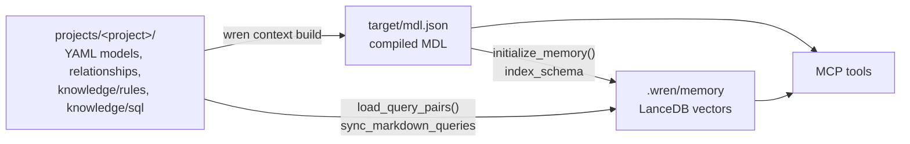

# Architecture

## Purpose

This repository is a standalone Wren AI OSS MCP service. It exposes a Wren
semantic layer over the Model Context Protocol (MCP) and has no dependency on a
chatbot, web application, or any other repository. Any MCP client can connect to
its HTTP endpoint.

## Two axes: semantic image variants and deployment environments

These are independent concerns.

|Axis|Controls|Artefact|
|---|---|---|
|Semantic project|Which models, relationships, rules and NL→SQL examples are compiled into the MDL|`projects/<project>/` copied into the image at build time|
|Deployment environment|Which database the compiled MDL is executed against|`config/profiles/<env>.yml` mounted at runtime|

One image variant per semantic project:

|Image variant|Build arg|Contents|Status|
|---|---|---|---|
|`wren-jaffle`|`WREN_PROJECT=jaffle-wren`|Jaffle semantic models + DuckDB fixture|DEV image|
|`wren-clickhouse`|`WREN_PROJECT=clickhouse-mart`|ClickHouse semantic models|Directories reserved; real schema and manifest required|

Configured as three isolated stacks:

|Stack|Compose project|Profile|Database|
|---|---|---|---|
|DEV|`wren-dev`|`jaffle-dev`|DuckDB fixture, baked into the image|
|Staging|`wren-staging`|`clickhouse-staging`|ClickHouse staging|
|Production|`wren-prod`|`clickhouse-prod`|ClickHouse production|

The same image digest can be deployed to staging and production only if the
semantic project matches. The Jaffle image is a DEV fixture; it is not a
staging artefact.

## Three layers of semantic state

- **Source** (`projects/<project>/`): YAML model definitions, relationships, and
  the `knowledge/` tree. Version-controlled, human-edited, reviewed in Git.
- **Compiled MDL** (`target/mdl.json`): generated by `wren context build`. Baked
  into the image at build time and read-only at runtime.
- **Derived memory** (`.wren/memory`): LanceDB vectors built at container start
  by `docker/initialize_memory.py`. Not version-controlled; lives in a named
  volume that is separate per Compose project.

Only the third layer is writable at runtime, and only by the initialization step
before the server binds its port.

## Environment isolation

Each stack interpolates its own values and mounts its own profile registry:

|Stack|Env file|Profile registry|Published ports|Memory volume|
|---|---|---|---|---|
|DEV|`.env.dev`|`config/profiles/dev.yml`|`127.0.0.1:${WREN_PORT}` (default 8080)|`wren-dev_wren_memory`|
|Staging|`.env.staging`|`config/profiles/staging.yml`|none (`expose` only)|`wren-staging_wren_memory`|
|Production|`.env.prod`|`config/profiles/prod.yml`|none (`expose` only)|`wren-prod_wren_memory`|

Staging and production publish no host port. They are reached over a private
network through an authenticating TLS reverse proxy; see
[deployment.md](deployment.md).

## Explicit profile selection

The Jaffle semantic project declares `data_source: duckdb` and no `profile:` field.
Profile selection is always explicit:

- the container sets `WREN_PROFILE` and `WREN_HOME`;
- Wren reads `<WREN_HOME>/profiles.yml`, which Compose bind-mounts read-only
  from `config/profiles/<env>.yml`;
- `wren serve mcp --profile "$WREN_PROFILE"` fails startup if the name is absent
  or if a `${CH_*}` placeholder cannot be resolved.

A project-pinned profile would override the registry's `active` entry and embed
an environment choice in semantic assets. That is why the imported
`profile: jaffle-shop` line was removed.

## Build once, select at runtime

- The Python environment (`pyproject.toml` + `uv.lock`) is built once per image.
- The semantic project is selected per image with `--build-arg WREN_PROJECT`.
- The database endpoint is selected per deployment with the profile registry.

Consequently there are no permanent per-environment branches and no
environment-specific rebuild: production pulls the exact digest that was tested
in staging. See [deployment.md](deployment.md#promotion-and-rollback).

## Runtime surface

- Transport: MCP streamable HTTP on `/mcp`, port 8080.
- Tools: `run_sql`, `dry_run`, `dry_plan`, `query_cube`, `get_mdl`,
  `list_models`, `describe_model`, `get_data_source`, `list_cubes`,
  `describe_cube`, `list_functions`, `get_instructions`, `recall_queries`,
  `get_context`, `describe_schema`, `list_stored_queries`, `list_knowledge`.
- `store_query` is **not** registered: the service never passes `--allow-write`.
- No authentication and no health endpoint are provided by Wren 0.17.1. The
  container healthcheck is a TCP liveness probe only, because Wren connects to
  its database lazily.

## Related guides

- [development.md](development.md) — local DEV stack, fixture, smoke test.
- [knowledge-and-memory.md](knowledge-and-memory.md) — curation and indexing.
- [deployment.md](deployment.md) — manual builds, promotion, rollback, access.
