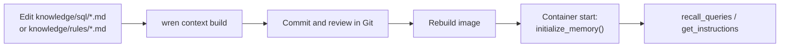

# Knowledge and memory

Three knowledge channels feed an MCP client, and they behave differently.

|Channel|Source path|Delivery|Writable at runtime|
|---|---|---|---|
|Schema context|`models/**/metadata.yml` descriptions|`get_context`, `describe_schema`, `get_mdl`|No|
|Query examples|`knowledge/sql/*.md`|`recall_queries`, `list_stored_queries`|No (`store_query` is not registered)|
|Business rules|`knowledge/rules/*.md`|`get_instructions`|No|

## Canonical source vs derived index

`knowledge/sql/*.md` is the source of truth. LanceDB under `.wren/memory` is a
derived artefact, in the same way `target/mdl.json` is derived from the YAML
models. Deleting the volume loses nothing: the next container start rebuilds it
from the baked sources.

`knowledge/rules/*.md` is **not** embedded. It is concatenated and returned
verbatim by `get_instructions`, so rule edits take effect as soon as the image
carrying them is deployed — no reindexing is involved.

## Adding a curated NL→SQL example

Create one file per pair under `projects/<project>/knowledge/sql/`. The
frontmatter is mandatory:

```markdown
---
nl: How many orders are there?
sql: |
  SELECT COUNT(*) AS order_count FROM orders
datasource: duckdb
source: user
tags:
  - orders
---
Counts every row in the `orders` model. Returns 99 for the Jaffle fixture.
```

|Field|Required|Notes|
|---|---|---|
|`nl`|Yes|The natural-language question clients will match against. Must be non-empty.|
|`sql`|Yes|SQL against MDL model names, not raw tables. Must be non-empty.|
|`datasource`|No|Used for datasource-filtered recall.|
|`source`|No|Defaults to `user`. Appears as `source:<value>` in the derived row.|
|`tags`|No|Curated labels for review; see the note on derived tags below.|
|body|No|Free-form notes for humans. Never indexed.|

The shipped example resolves to `99` for the Jaffle fixture and is asserted by
the smoke client, which is what makes a silent indexing failure observable.

### Validation rules

- A file whose frontmatter is missing, unparseable, or lacks a non-empty `nl` or
  `sql` is **skipped** by the upstream loader. Upstream is deliberately lenient
  here so one bad file cannot break recall entirely. The consequence: a typo
  removes a pair silently. That is why the smoke client asserts the curated pair
  is retrievable.
- Editing the NL of an existing pair creates a new pair and drops the old
  Markdown-synchronized row; synchronization uses NL text as the upsert key.
- Editing only the SQL of an existing pair replaces the stored SQL.

### Derived tag rewrite

Conflict: Markdown `tags:` do not survive verbatim into vector rows. The sync
path writes provenance tags (`source:<source>` plus `origin:markdown-sync`) and
does not carry the curated tag list. Treat `tags:` as review metadata, and use
`source:` for any filtering you rely on at query time.

## Curation workflow



1. Add or edit the Markdown file.
2. Compile and check the semantic project:

   ```bash
   uv run --frozen wren context validate --path projects/jaffle-wren
   uv run --frozen wren context build --path projects/jaffle-wren
   ```

3. Confirm the pair parses with Wren's loader:

   ```bash
   uv run --frozen python - <<'PY'
   from pathlib import Path
   from wren.memory.markdown import load_query_pairs

   for pair in load_query_pairs(Path("projects/jaffle-wren")):
       print(pair["nl"], "->", pair["sql"].strip())
   PY
   ```

4. Commit the Markdown (never `target/` or `.wren/`).
5. Rebuild and redeploy the image; run `scripts/smoke_mcp.py`.

There is no deployed write path. `store_query` is unregistered because the
service never passes `--allow-write`, so a client cannot inject or mutate pairs.
That keeps every change reviewable in Git.

## What startup synchronization does

`docker/initialize_memory.py` runs on every container start, before the server
listens. For `<project>`:

1. Read `target/mdl.json`.
2. `MemoryStore(path=<project>/.wren/memory)`.
3. `index_schema(manifest, replace=True, seed_queries=False)` — rebuild the
   schema vectors, never generate auto-seed pairs.
4. `forget_queries_by_source("seed")` — clear seed rows written by an older
   index so a previously seeded volume converges to curated-only memory.
5. `sync_markdown_queries(load_query_pairs(project))` — upsert every Markdown
   pair and forget rows this sync previously wrote that no longer exist.

Consequences:

|Situation|Result|
|---|---|
|Empty `knowledge/sql/`|Valid. Schema vectors exist; recall returns no curated matches.|
|Pair SQL edited, NL unchanged|Stored `sql_query` is replaced.|
|Pair Markdown deleted|The derived row it previously wrote is forgotten.|
|Volume from an older build|Schema is replaced, seed rows are dropped, pairs converge.|
|Malformed Markdown|That file is skipped; other pairs still index.|
|Import, embedding, or permission error|Startup fails nonzero; the server never listens.|

`seed_queries=False` with the explicit seed purge is what keeps
`list_stored_queries` free of generated rows — asserted by the smoke client.

## Startup failure policy

Initialization is fail-closed by design:

- a missing `target/mdl.json` raises `FileNotFoundError`;
- an unloadable embedding model raises;
- a read-only or full `.wren/memory` volume raises on write;
- `MemoryStore` errors propagate unchanged.

Initialization uses the LanceDB API directly and propagates errors.
`HF_HUB_OFFLINE=1` makes model loading local; a missing cache entry fails startup.
Wren's separate MCP recall implementation can fall back to grep if its memory
dependencies are unavailable.

## Embedding backend

|Setting|Value|Why|
|---|---|---|
|`WREN_MEMORY_BACKEND`|`lancedb`|Vector recall rather than token overlap|
|`WREN_EMBEDDING_BACKEND`|`onnx`|Torch-free; same weights via onnxruntime|
|`WREN_EMBEDDING_MODEL`|`paraphrase-multilingual-MiniLM-L12-v2`|Wren's default multilingual model|
|`HF_HOME`|`/opt/wren-model-cache`|Cache baked at build time|
|`HF_HUB_OFFLINE`|`1`|No runtime downloads|

The build asserts `warm_up(...) == 384`, so a silent model swap that changes the
vector dimension fails the build instead of producing an unusable index.

## Schema descriptions matter

Column and model descriptions in `metadata.yml` are embedded into the schema
vector table. They are the only place a client learns that, for example,
`amount` is the AUD order total or that `number_of_orders` is NULL rather than 0
for a customer with no orders. Rules in `knowledge/rules/*.md` complement them
but do not reach `get_context`.
